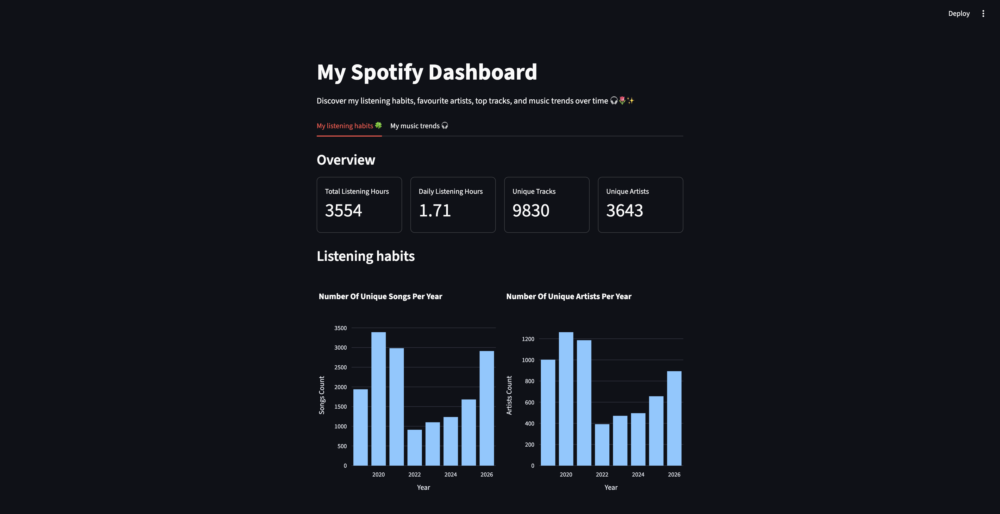
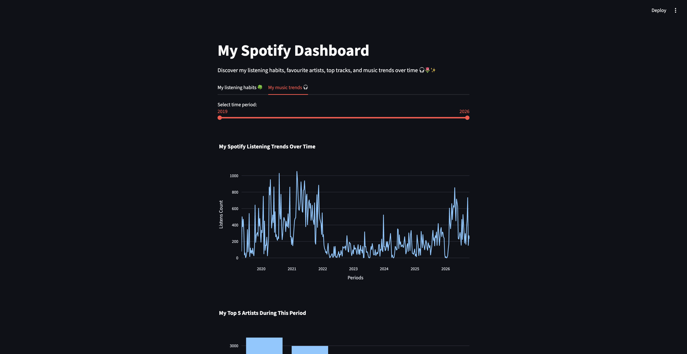
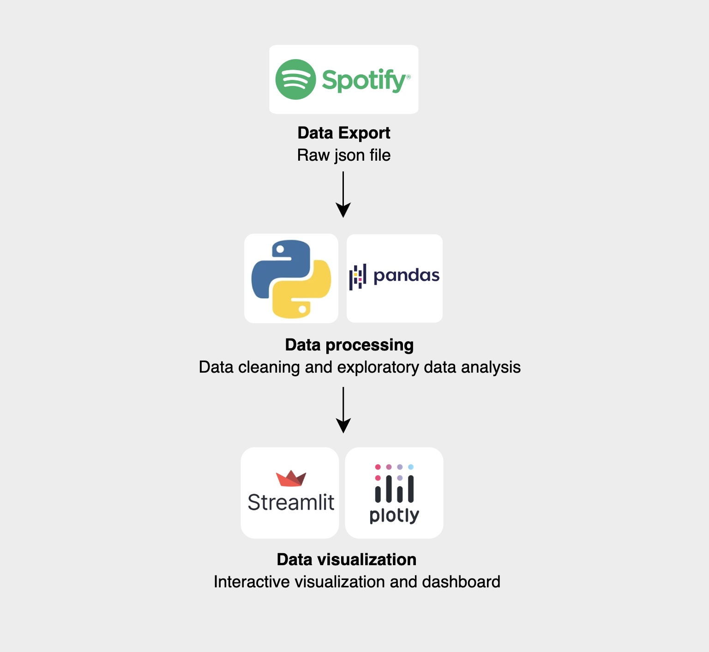

# 🎧 My spotify analysis

### 🔎 Project Overview

**Project description**: This project analyzes my personal spotify data and visualize data using an interactive dashboard.

**Data source**: My personal listening history exported from [Spotify](https://open.spotify.com/)

**Features**:

- Overview of my listening habits



- My music trends with slider by year



### 📁 Project Structure
```
my-spotify-analysis/
├── my_spotify_data                     # data file
│   ├── raw/
│   └── processed/
├── dashboard.py                        # interactive dashboard
├── my_spotify_analysis.ipynb           # data cleaning & EDA
├── requirements.txt
└── README.md
```

### Project Workflow & Toolkits


